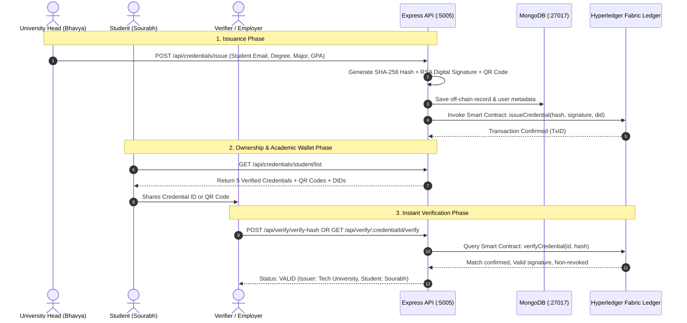

# 🎓 Academic Credential Verification System (ACVS)

> **Decentralized, Immutable, and Privacy-Preserving Academic Credential Verification Framework powered by Hyperledger Fabric, W3C Decentralized Identifiers (DID), and MongoDB.**

[](https://www.hyperledger.org/projects/fabric)
[](https://nodejs.org)
[](https://expressjs.com)
[](https://react.dev)
[](https://www.mongodb.com)
[](#cryptographic-security)
[](LICENSE)
[](https://github.com/sourabh-sk1)

---

## 📑 Table of Contents

- [Overview](#-overview)
- [System Architecture](#-system-architecture)
- [Core Features by Role](#-core-features-by-role)
- [Cryptographic & Blockchain Security](#-cryptographic--blockchain-security)
- [Technology Stack](#-technology-stack)
- [Project Directory Structure](#-project-directory-structure)
- [Getting Started](#-getting-started)
  - [Prerequisites](#prerequisites)
  - [Environment Configuration](#environment-configuration)
  - [Installation & Running](#installation--running)
- [Pre-Seeded Demo Accounts & Credentials](#-pre-seeded-demo-accounts--credentials)
- [REST API Reference](#-rest-api-reference)
- [Author & License](#-author--license)

---

## 🌟 Overview

Credential fraud is a widespread global issue: diploma mills, forged physical transcripts, and altered digital PDFs cost institutions and employers billions in manual verification and background checks.

**ACVS** solves this by establishing a decentralized trust triangle between **Accredited Universities**, **Students**, and **Verifiers (Employers/Institutions)**:
1. **Universities** cryptographically sign and anchor degrees and certificates directly to a distributed ledger.
2. **Students** retain self-sovereign ownership of their verifiable credentials via **W3C Decentralized Identifiers (DID)**.
3. **Verifiers** instantly confirm authenticity, issuing institution, and non-revocation status in seconds using a **Credential ID** or **QR Code**—without relying on manual phone calls or centralized server intermediaries.

---

## 🏛 System Architecture

The platform implements a **Hybrid On-Chain / Off-Chain Architecture** designed for enterprise performance, zero gas fees, and student data privacy.



### Storage Segregation:
* **On-Chain (Hyperledger Fabric Ledger)**: Stores immutable proofs only: SHA-256 credential fingerprint, issuer DID, student DID, cryptographic signature, and revocation flags.
* **Off-Chain (MongoDB)**: Stores high-speed application state, user accounts, audit histories, and UI data.
* **Decentralized Storage (IPFS)**: Supports decentralized document hosting for certificate assets via content-addressed hashing.

---

## 👥 Core Features by Role

### 1. 🎓 University Issuer Portal (`UNIVERSITY_ISSUER`)
* **Role Head**: **Bhavya** (`university@example.com`)
* **Issue Degrees & Diplomas**: Create tamper-proof academic credentials for any registered student email.
* **Cryptographic Signing**: Every issuance automatically generates an RSA-2048 digital signature and SHA-256 digest.
* **Revocation Management**: Universities maintain the authority to revoke credentials (e.g. academic fraud) while retaining an immutable on-chain audit log with timestamps and justification.

### 2. 🎒 Student Portal (`STUDENT`)
* **Student**: **Sourabh** (`2005sourabhkumar@gmail.com`)
* **Decentralized Academic Wallet**: Holds all degrees, certificates, and diplomas issued by accredited universities.
* **Interactive QR Code Generator**: Each credential generates an on-the-fly QR code for instant scanning by recruiters and admission offices.
* **One-Click Credential ID Sharing**: Quick copy utility to share verification tokens with recruiters.
* **Cryptographic Profile**: Transparent display of W3C DID (`did:fabric:...`) and RSA Public Key.

### 3. 🔍 Verifier Portal (`VERIFIER`)
* **Verifier**: **Acme Corp HR** (`verifier@example.com`)
* **Direct ID Verification**: Enter any Credential ID (e.g. `CRED-...`) to query authenticity against the blockchain ledger.
* **Cryptographic Hash Verification**: Verify arbitrary document hashes against ledger state.
* **Tamper-Proof Audit Trail**: Produces a verifiable proof report detailing university identity, issue date, and validity.

---

## 🔐 Cryptographic & Blockchain Security

| Security Layer | Technology | Purpose |
| :--- | :--- | :--- |
| **Identity Standard** | **W3C Decentralized Identifier (DID)** | Ensures self-sovereign identity without reliance on central identity providers. |
| **Content Integrity** | **SHA-256 Cryptographic Hashing** | Any alteration to student name, major, or GPA changes the digest and invalidates verification. |
| **Authenticity Proof** | **Asymmetric RSA-2048 Digital Signatures** | Proves the certificate was authentically signed by the authorized university head. |
| **Consortium Ledger** | **Hyperledger Fabric Smart Contracts** | Permissioned distributed ledger with zero transaction fees and instant finality. |
| **Transit Security** | **JWT + BCrypt + Helmet + CORS** | Industry-standard token authentication and endpoint security hardening. |

---

## 🛠 Technology Stack

### Frontend
* **React 18**: Single-page application architecture.
* **TailwindCSS**: Premium responsive UI design with dark mode support.
* **Zustand**: Clean client-side authentication state management.
* **QRCode.react**: Client-side QR generation for verifiable credentials.
* **React Router v6**: Client routing with role-based `ProtectedRoute` guards.
* **React Icons**: Feather & Heroicons modern iconography.

### Backend & API
* **Node.js & Express.js**: RESTful API server.
* **Mongoose (v7)**: MongoDB object modeling.
* **JSON Web Tokens (JWT)**: Stateless authentication.
* **BCrypt.js**: Salted password hashing.
* **Winston**: Enterprise application logging.

### Blockchain & Decentralized Storage
* **Hyperledger Fabric**: Permissioned enterprise blockchain network.
* **Fabric Contract API**: Smart contracts written in JavaScript (`credential-contract.js`).
* **IPFS HTTP Client**: Decentralized document hosting interface.

---

## 📂 Project Directory Structure

```text
blockchain-credential-verification/
├── backend/
│   ├── config/
│   │   └── database.js              # MongoDB Mongoose connection handler
│   ├── controllers/
│   │   ├── authController.js        # Authentication & profile endpoints
│   │   ├── credentialController.js  # Issuance & student credential queries
│   │   └── verificationController.js# Verification & audit logic
│   ├── middleware/                  # JWT auth, authorization, error handlers
│   ├── models/
│   │   ├── User.js                  # User schema (Student, University, Verifier)
│   │   ├── Credential.js            # Credential schema (Hashes, signatures, metadata)
│   │   ├── Verification.js          # Verification logs
│   │   └── AuditLog.js              # Audit trail records
│   ├── routes/                      # API route definitions
│   ├── services/
│   │   ├── fabricService.js         # Hyperledger Fabric gateway connector
│   │   ├── didService.js            # W3C DID generator
│   │   └── ipfsService.js           # IPFS storage service
│   ├── utils/
│   │   └── cryptography.js          # SHA-256 hashing & RSA signing
│   └── server.js                    # Express application entrypoint
├── blockchain/
│   ├── hyperledger-fabric/          # Network configuration & enrollments
│   └── smart-contracts/
│       └── credential-contract.js   # Hyperledger Fabric Chaincode
├── frontend/
│   ├── public/                      # Static assets & HTML template
│   └── src/
│       ├── components/
│       │   ├── Layout.js            # Sidebar navigation & theme toggle
│       │   ├── ProtectedRoute.js    # Role-based route authorization
│       │   └── ThemeToggle.js       # Light / Dark mode switcher
│       ├── pages/
│       │   ├── StudentPortal.js     # Student academic wallet & QR codes
│       │   ├── UniversityDashboard.js# University issuance dashboard
│       │   ├── VerifierPortal.js    # Credential verification engine
│       │   ├── ProfilePage.js       # User DID & Cryptographic Key viewer
│       │   ├── LoginPage.js         # Authentication portal
│       │   └── RegisterPage.js      # User registration portal
│       ├── services/api.js          # Axios API client
│       └── store/authStore.js       # Zustand auth store
├── docker/
│   └── docker-compose.yml           # Multi-container deployment configuration
└── README.md
```

---

## 🚀 Getting Started

### Prerequisites
* **Node.js**: v18.0.0 or higher
* **npm**: v9.0.0 or higher
* **MongoDB**: Running locally on `mongodb://localhost:27017/`

### Environment Configuration

Create a `.env` file in the project root:

```env
# Backend Configuration
BACKEND_PORT=5005
NODE_ENV=development

# Database
MONGODB_URI=mongodb://localhost:27017/academic-credentials

# JWT & Security
JWT_SECRET=super_secret_jwt_key_academic_credentials_2026
JWT_EXPIRE=7d

# Hyperledger Fabric
FABRIC_NETWORK_PROFILE=./blockchain/hyperledger-fabric/network.json
FABRIC_CA_URL=http://localhost:7054
FABRIC_PEER_URL=grpc://localhost:7051
FABRIC_ORDERER_URL=grpc://localhost:7050
FABRIC_CHANNEL_NAME=credential-channel
FABRIC_CHAINCODE_NAME=credential-contract
FABRIC_CHAINCODE_VERSION=1.0.0

# Frontend
REACT_APP_API_URL=http://localhost:5005/api
CORS_ORIGIN=http://localhost:3000
```

### Installation & Running

1. **Install Backend Dependencies**:
   ```bash
   cd backend
   npm install
   ```

2. **Install Frontend Dependencies**:
   ```bash
   cd ../frontend
   npm install
   ```

3. **Start Backend Server**:
   ```bash
   cd ../backend
   npm start
   # Server runs on http://localhost:5005
   ```

4. **Start Frontend Web App**:
   ```bash
   cd ../frontend
   npm start
   # Application opens on http://localhost:3000
   ```

---

## 🔑 Pre-Seeded Demo Accounts & Credentials

The local database comes pre-configured with active accounts across all roles:

| Role | Name | Email | Password | Primary Capabilities |
| :--- | :--- | :--- | :--- | :--- |
| **Student** | **Sourabh** | `2005sourabhkumar@gmail.com` | *(Your password)* | Holds 5 verified credentials, QR viewer, DID wallet |
| **University Issuer** | **Bhavya** | `university@example.com` | `UniPass123!` | Issues and revokes degrees, digital signatures |
| **Verifier** | **Acme Corp HR** | `verifier@example.com` | `VerifyPass123!` | Verifies degrees by Credential ID or SHA-256 hash |

### Live Test Credential IDs (Ready for Verification)
Paste any of these into the **Verifier Portal** (`http://localhost:3000/verifier-portal`):
* `CRED-1791729892481-4625A231F7CBFB25` — *Certified Blockchain Architect & Smart Contract Developer*
* `CRED-1791729892486-7E22D46C9D41850C` — *Honors Diploma in Advanced Cybersecurity & Cryptography*
* `CRED-1791729892487-5A16C8F2B75060BC` — *Master of Science in Distributed Cloud Systems*
* `CRED-1791728791091-56EAD11F3C9AB95A` — *Bachelor of Technology in Computer Science & Engineering*

---

## 📡 REST API Reference

### Authentication Endpoints
* `POST /api/auth/register` — Register a new student, university, or verifier.
* `POST /api/auth/login` — Authenticate and receive a JWT Bearer token.
* `GET /api/auth/profile` — Retrieve current user identity, DID, and Public Key.

### Credential Endpoints
* `POST /api/credentials/issue` — Issue a new academic degree/diploma *(University only)*.
* `GET /api/credentials/student/list` — Retrieve all credentials for authenticated student *(Student only)*.
* `GET /api/credentials/:credentialId` — Retrieve detailed credential metadata.
* `POST /api/credentials/:credentialId/revoke` — Revoke credential with reason *(University only)*.

### Verification Endpoints
* `GET /api/verify/:credentialId/verify` — Verify credential by Credential ID.
* `POST /api/verify/verify-hash` — Verify credential authenticity by SHA-256 hash.
* `GET /api/verify/:credentialId/history` — Inspect verification audit log history.

---

## 👤 Author & License

* **Project Owner**: **sourabh-sk1** ([@sourabh-sk1](https://github.com/sourabh-sk1))
* **License**: This project is licensed under the **MIT License** — feel free to use and modify for academic and commercial purposes.
